# Screenshot gallery

These are genuine screenshots of the SalesPulse demo, captured against the committed demo database
(clean data plus the messy-dataset audit). All visible customers, products, orders, payments, and
returns are **synthetic**. No screenshot is a mockup, and no metric was typed into an image
manually.

## Capture environment

| Item | Detail |
|---|---|
| Application | `streamlit run app.py` at `http://localhost:8501` |
| Database | `data/processed/salespulse.db` after `demo --reset --regenerate-data --with-messy` |
| Browser | Google Chrome, headless, Playwright |
| Viewport | 1560 × 1000 CSS pixels; no browser chrome or desktop in the frame |
| Data filter | Full demo range, 2025-01-03 → 2026-06-30 |
| Workbook | `output/sales_report.xlsx` generated by the demo/export command |

Images `01`–`06`, `08`–`12` are direct viewport captures. `07` and `13` are rasterizations of the
actual workbook: the workbook was exported to PDF with LibreOffice and rendered to PNG. `12` is a
scrolled capture; two import-history rows remain visible above the rejection report as natural
page context.

## Dashboard

### `01_dashboard_overview.png`

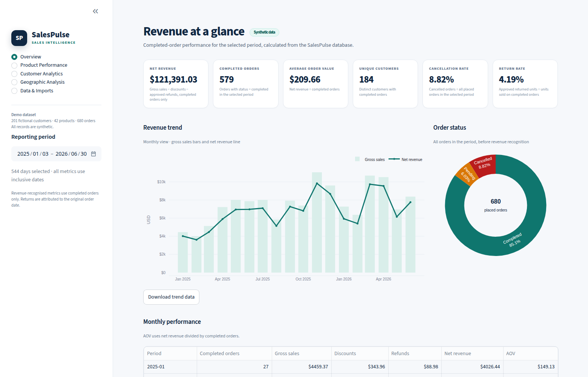

The Overview page for the full demo period: net revenue, completed orders, AOV, purchasing
customers, cancellation rate, return rate, monthly revenue trend, order-status mix, and the start of
the monthly performance table.

## Import and validation workflow

### `02_data_upload.png`

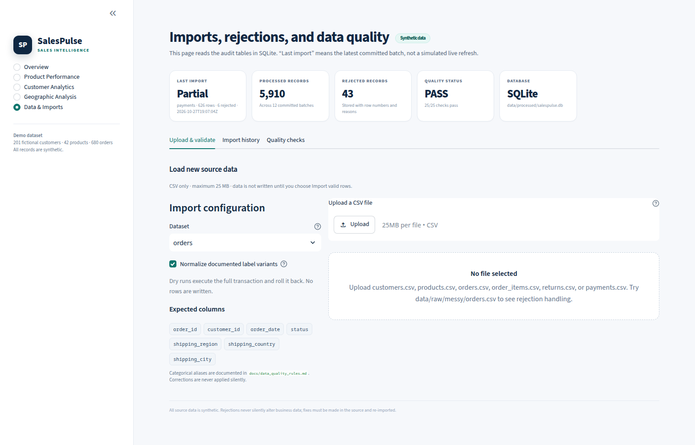

**Data & Imports → Upload & validate** before a file is chosen. The page shows the audit KPIs,
dataset selector (`orders`), normalization option, expected-column chips, 25 MB limit, and the
empty upload state.

### `03_data_profile.png`

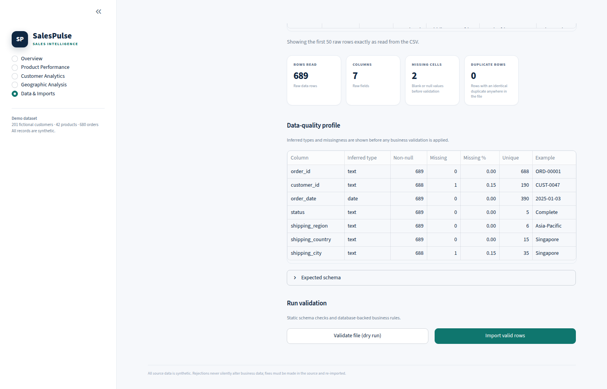

After uploading `data/raw/messy/orders.csv`: 689 rows, 7 columns, 2 missing cells, 0 exact duplicate
rows, and the inferred-type/missingness table for every source column. This is the raw profile,
before business validation.

### `04_import_configuration.png`

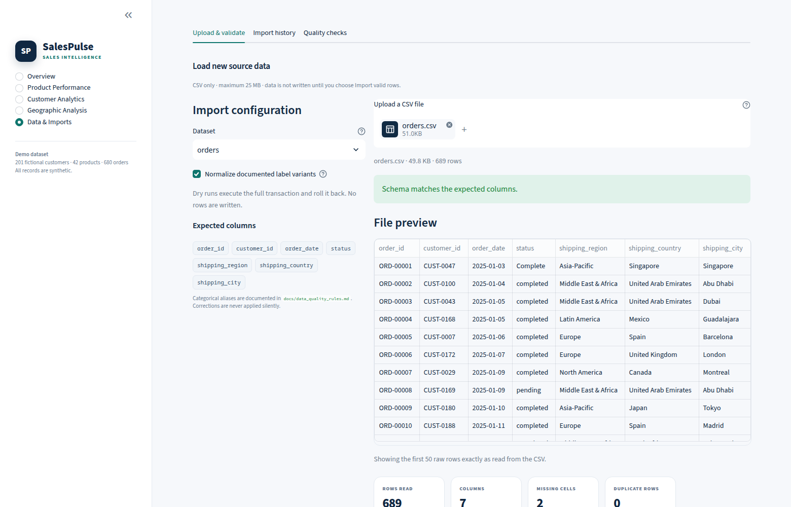

The same upload in context: `orders.csv`, 48.8 KB, schema-match confirmation, the first 50 raw rows,
and the import configuration. Dataset `orders` is selected, so the expected columns are order
fields.

### `05_dry_run_validation.png`

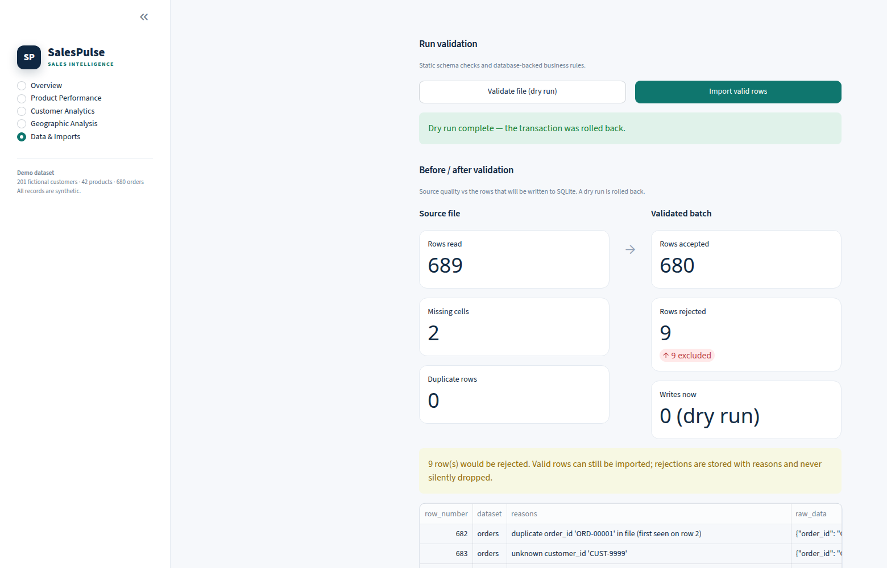

After pressing **Validate file (dry run)**: 689 rows read, 2 missing cells, 680 accepted, 9
rejected, and **0 writes** because the transaction was rolled back. The rejection sample shows the
duplicate order and unknown customer. The full rejection table is available below the fold and as
a download.

### `06_import_history.png`

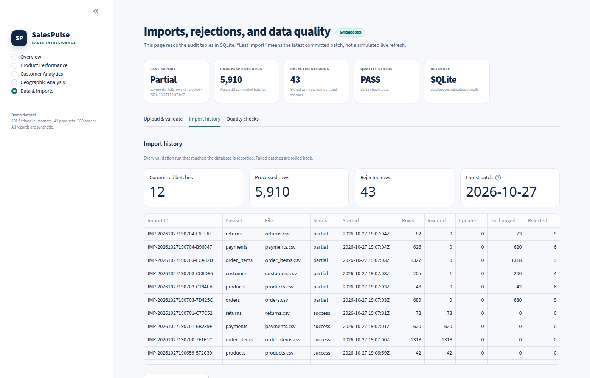

**Import history** tab: 12 committed batches, 5,910 processed rows, 43 rejected rows, the latest
batch date, and the batch table with per-dataset inserted/updated/unchanged/rejected counts.

## Excel reporting

### `07_excel_export.png`

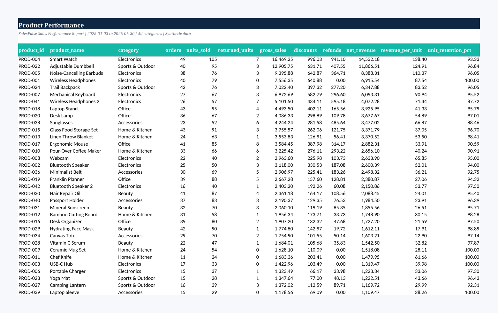

The real **Product Performance** worksheet from `output/sales_report.xlsx`, rendered from the
exported workbook. It shows the branded header, period, synthetic-data label, styled table, and 42
product rows with revenue and retention measures.

### `13_excel_readme.png`

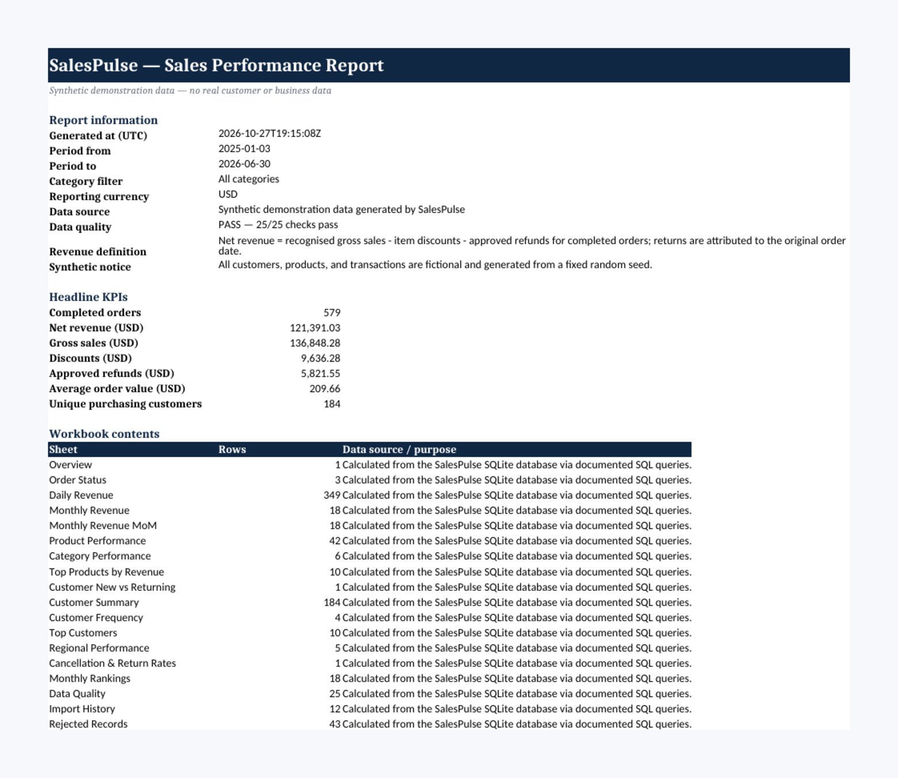

The workbook's **Read Me** sheet: report metadata, revenue definition, headline KPIs, and the
19-sheet contents map with row counts and data source. This image is an additional workbook
screenshot beyond the reference set.

## Analytics pages

### `08_product_performance.png`

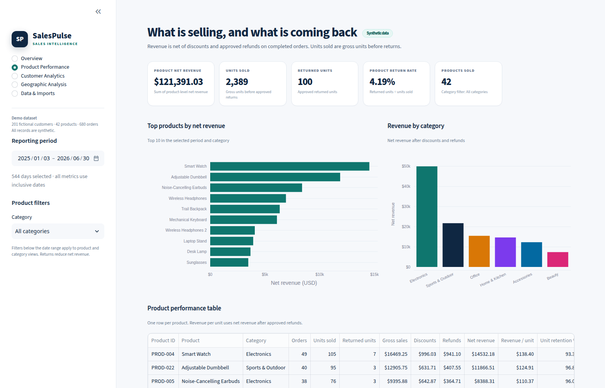

Product net revenue, units sold, returned units, return rate, products sold, top-10 products,
category revenue, and the product table. Category filter: **All categories**.

### `09_customer_analytics.png`

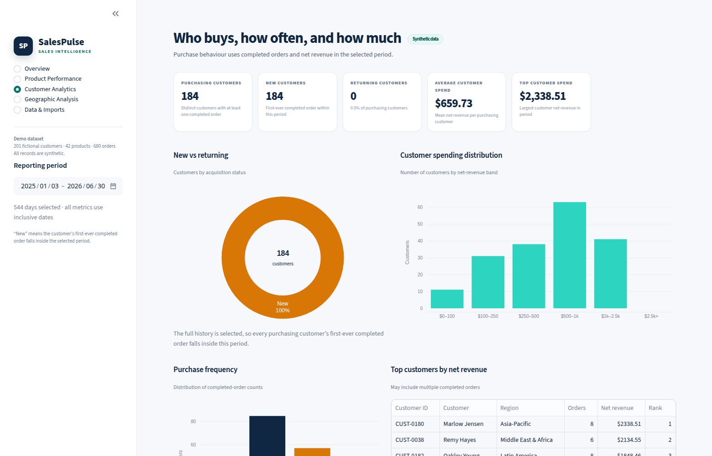

184 purchasing customers, new vs. returning mix, average and top customer spend, spending
distribution, purchase-frequency chart, and the top-customer table. With the full history selected,
all 184 customers are new; the caption explains that this reflects the available history rather than
a broken returning segment.

### `10_geographic_analysis.png`

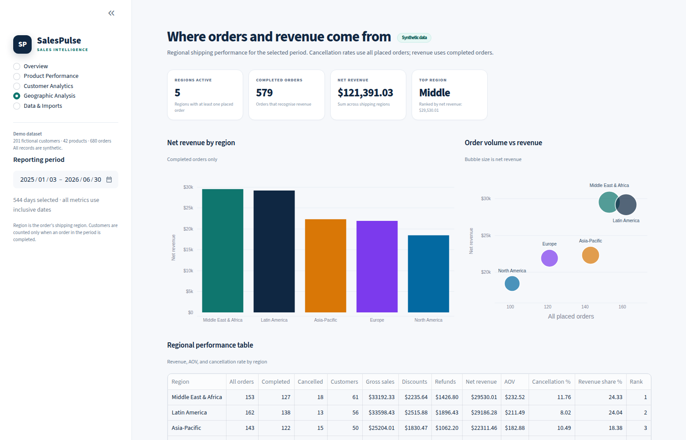

Revenue by shipping region, order-volume-vs-revenue bubble view, and the regional table with
completed/cancelled orders, unique customers, AOV, cancellation rate, revenue share, and rank.
Middle East & Africa leads with **$29,530.01** net revenue.

## Data quality and rejections

### `11_data_quality.png`

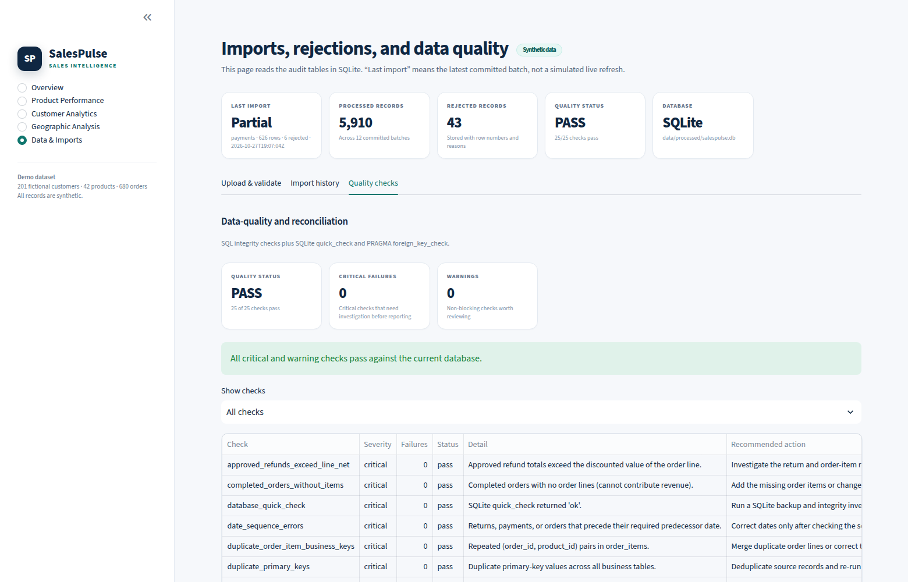

**Data & Imports → Quality checks**: PASS, 25/25 checks, 0 critical failures, 0 warnings, and the
sortable check table with severity, failure count, detail, and recommended action.

### `12_import_rejections.png`

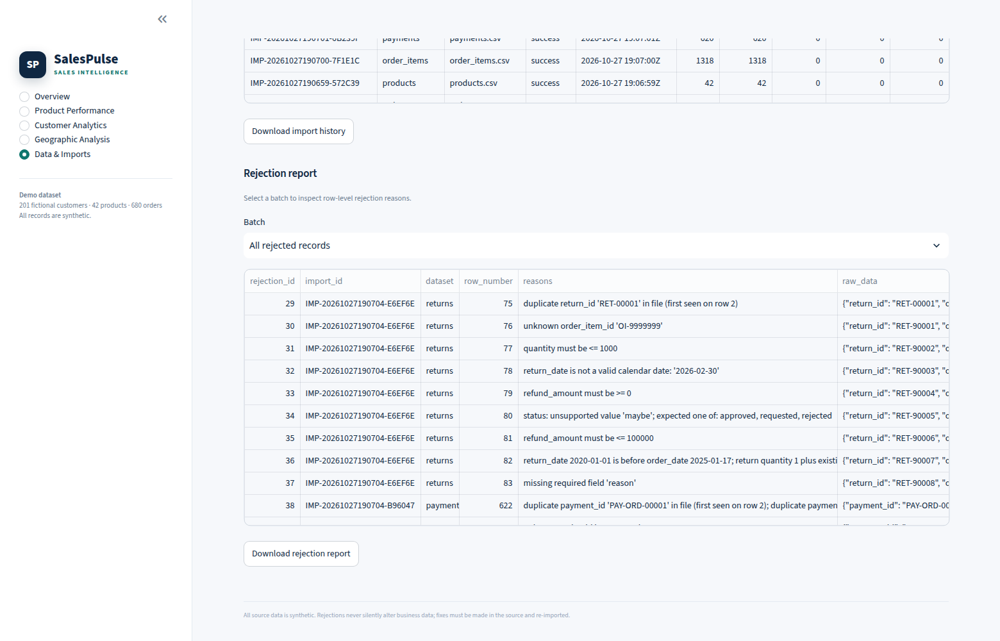

**Import history → Rejection report** with **All rejected records** selected: row-level reasons and
raw JSON for the rejected returns and payment rows, plus the rejection-report download. The two
history rows at the top are the natural result of scrolling, not an overlay.

---

## Screenshot checklist

The filenames follow a generic analytics-portfolio checklist (dashboard, import workflow, analytics
pages, quality, reporting). Each file was captured from the corresponding SalesPulse screen; no
mockup, external product, or stock image is included.

| Screenshot intent | File | SalesPulse view actually captured |
|---|---|---|
| Dashboard overview | `01_dashboard_overview.png` | SalesPulse **Overview** |
| Data upload | `02_data_upload.png` | **Data & Imports → Upload & validate**, no file selected |
| Data profile | `03_data_profile.png` | Raw-file profile after uploading messy `orders.csv` |
| Import configuration | `04_import_configuration.png` | Dataset `orders`, expected columns, and file preview |
| Dry-run validation | `05_dry_run_validation.png` | **Validate file (dry run)** result and rejection sample |
| Import history | `06_import_history.png` | **Import history** tab and batch table |
| Excel export | `07_excel_export.png` | **Product Performance** sheet of the generated workbook |
| Product performance | `08_product_performance.png` | SalesPulse **Product Performance** page |
| Customer analytics | `09_customer_analytics.png` | SalesPulse **Customer Analytics** page |
| Geographic analysis | `10_geographic_analysis.png` | SalesPulse **Geographic Analysis** page |
| Data quality | `11_data_quality.png` | **Quality checks** tab |
| Import rejections | `12_import_rejections.png` | **Rejection report** with all rejected records |
| Workbook Read Me | `13_excel_readme.png` | **Read Me** sheet of the same workbook |

Every image is a genuine capture of this application or of the workbook produced by the documented
demo command.

## Reproducing the captures

1. Run the full demo:

   ```bash
   python -m salespulse.cli demo --reset --regenerate-data --with-messy
   ```

2. Start the dashboard:

   ```bash
   streamlit run app.py
   ```

3. Use the demo database and select the full date range in the sidebar.

4. For `02`–`05`, choose dataset **orders** and upload `data/raw/messy/orders.csv`.

5. For `07` and `13`, open `output/sales_report.xlsx`; the images were produced from the workbook's
   printed pages, not from a separate design file.

The screenshots are documentation artifacts, not generated by the test suite. The data values are
reproducible from seed `42`, data version `1.0.0`, and the documented demo command.

## Verification notes

- Screenshot `01` shows the same headline values as the report: $121,391.03 net revenue, 579
  completed orders, $209.66 AOV, 184 purchasing customers, 8.82% cancellation rate, 4.19% return
  rate.
- `06` shows 12 committed batches, 5,910 processed rows, and 43 rejections, matching
  `output/import_summary.json`.
- `11` shows 25/25 checks passing, matching `output/csv/16_data_quality.csv`.
- `07` shows the same 42 product rows as `output/csv/06_product_performance.csv`; the top row is
  Smart Watch with 105 units and $14,532.18 net revenue.
- `13` lists 19 sheets and the same 43 rejected records as the workbook's **Rejected Records**
  sheet.
- The dashboard sidebar's **201 fictional customers** reflects the clean 200 plus one accepted,
  normalizable customer from the messy file; the other 43 messy rows are rejections.
